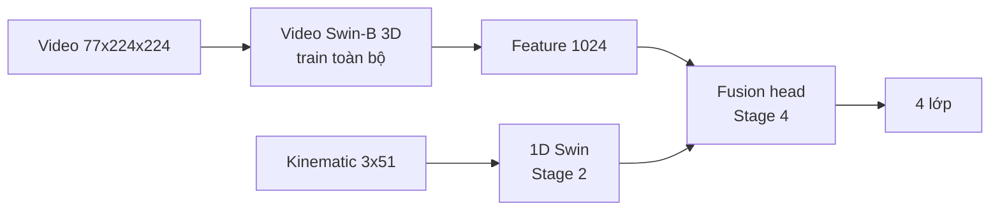
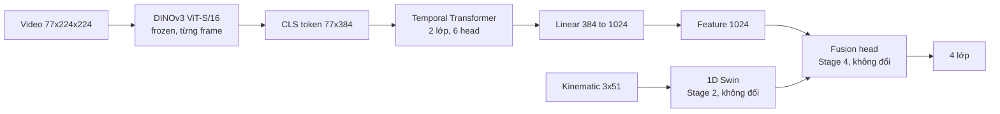

# Checking-Driver: DuST với video encoder DINOv3

Repo này là bản thử nghiệm dựa trên **DuST: Dual Swin Transformer for Multi-modal Video and Time-Series Modeling** ([repo gốc](https://github.com/datadrivenwheels/DUST), [paper CVPRW 2024](https://openaccess.thecvf.com/content/CVPR2024W/WAD/html/Shi_DuST_Dual_Swin_Transformer_for_Multi-modal_Video_and_Time-Series_Modeling_CVPRW_2024_paper.html)).

**Thay đổi chính:** video encoder **Video Swin Transformer 3D** được thay bằng **DINOv3 ViT-S/16** (bản DINOv3 nhỏ nhất, frozen) cộng một Temporal Transformer nhỏ. Ý tưởng, 4 stage huấn luyện, nhánh 1D Swin cho chuỗi thời gian và fusion head **giữ nguyên** như repo gốc. Bộ dữ liệu thử nghiệm là **UAH-DriveSet** (phân loại kiểu lái: bình thường / hung hăng / buồn ngủ).

Tài liệu này liệt kê **mọi chỗ khác so với repo gốc**, theo từng file.

## Mục lục

1. [Tóm tắt thay đổi](#1-tóm-tắt-thay-đổi)
2. [Pipeline: gốc và DINOv3](#2-pipeline-gốc-và-dinov3)
3. [Ánh xạ file với repo gốc](#3-ánh-xạ-file-với-repo-gốc)
4. [Chi tiết thay đổi từng file](#4-chi-tiết-thay-đổi-từng-file)
5. [Lỗi tìm thấy trong repo gốc và cách xử lý](#5-lỗi-tìm-thấy-trong-repo-gốc-và-cách-xử-lý)
6. [Thành phần mới không có trong repo gốc](#6-thành-phần-mới-không-có-trong-repo-gốc)
7. [Cài đặt và chạy](#7-cài-đặt-và-chạy)
8. [Kết quả hiện tại](#8-kết-quả-hiện-tại)
9. [Giới hạn và bản quyền](#9-giới-hạn-và-bản-quyền)

---

## 1. Tóm tắt thay đổi

| Thành phần | Repo gốc DuST | Repo này |
|---|---|---|
| Video encoder | Video Swin-B 3D (`embed_dim=128`, `depths=[2,2,18,2]`), fine-tune toàn bộ | DINOv3 ViT-S/16 **frozen** + Temporal Transformer 2 lớp |
| Pretrain video | Swin-B ImageNet, inflate 2D → 3D | DINOv3 LVD-1689M (`vit_small_patch16_dinov3.lvd1689m`) |
| Mô hình thời gian trong video | 3D shifted-window attention + patch merging | Temporal Transformer trên CLS token từng frame |
| Gộp đặc trưng video | `AdaptiveAvgPool3d` → vector 1024 | Temporal CLS token → `Linear(384 → 1024)` |
| Số tham số Stage 1 | ~88M, train toàn bộ | 25.5M tổng, **3.95M train được** |
| Đầu vào video | `(B, 3, 77, 224, 224)` | **Không đổi** |
| Video feature cho fusion | `(N, 1024)` | **Không đổi** |
| Nhánh 1D Swin (Stage 2) | 1D Swin, `embed_dim=256` | **Không đổi** |
| Fusion (Stage 4) | `Linear(num_features + 1024, 4)` | **Không đổi** (sửa `embed_dim` cho khớp Stage 2, xem mục 5) |
| Optimizer, scheduler, loss, epoch, batch | AdamW + CombinedLRScheduler / Adam, CrossEntropy | **Không đổi** |
| Lưu checkpoint | Mỗi lần đánh giá 1 file | Mặc định chỉ `best_*.pth` + `final_*.pth` (`--save_all_epochs` để như gốc) |
| Dữ liệu | Toy data ngẫu nhiên (`gen_data.py`) | UAH-DriveSet thật, qua `prepare_uah_data.py` |

---

## 2. Pipeline: gốc và DINOv3

**Repo gốc**



**Repo này** (chỉ khối video thay đổi)



Thứ tự 4 stage giữ nguyên:

| Stage | Repo gốc | Repo này |
|---|---|---|
| 1. Train video encoder | `step_fusion_3d.py` | `step_dinov3_3d.py` |
| 2. Train 1D Swin | `step_fusion_1d.py` | `step_fusion_1d.py` |
| 3. Trích video feature | `step_fusion_3d_get_feature.py` | `step_dinov3_3d_get_feature.py` |
| 4. Train fusion | `step_fusion.py` | `step_fusion.py` |

---

## 3. Ánh xạ file với repo gốc

| File trong repo này | File gốc | Trạng thái |
|---|---|---|
| `models/dinov3_video_encoder.py` | `models/video_swin_transformer.py` | **Mới**, thay thế |
| `models/SwinTransformer_cls.py` | `models/SwinTransformer_cls.py` | Chép nguyên, không sửa |
| `models/SwinTransformer_fusion.py` | `models/SwinTransformer_fusion.py` | Chép nguyên, không sửa |
| `models/__init__.py` | (không có) | Mới: export encoder, cho phép dùng `models/` của repo gốc nếu đặt repo này bên trong |
| `step_dinov3_3d.py` | `step_fusion_3d.py` | Thay model, giữ vòng train |
| `step_dinov3_3d_get_feature.py` | `step_fusion_3d_get_feature.py` | Thay model, sửa lỗi thứ tự feature |
| `step_fusion_1d.py` | `step_fusion_1d.py` | Logic giữ nguyên, sửa đường dẫn + lưu checkpoint |
| `step_fusion.py` | `step_fusion.py` | Logic giữ nguyên, sửa `embed_dim`, lưu checkpoint |
| `prepare_uah_data.py` | `gen_data.py` (toy data) | **Mới**: làm sạch + chuyển UAH-DriveSet |
| `notebooks/run_colab.ipynb` | (không có) | **Mới**: chạy dữ liệu + 4 stage trên Colab |
| `docs/USAGE.md` | `README.md` | Hướng dẫn chạy chi tiết |
| `docs/README_DATA.md` | (không có) | **Mới**: tài liệu UAH-DriveSet |
| (không có) | `models/video_swin_transformer.py`, `gen_data.py` | Không dùng nữa |

---

## 4. Chi tiết thay đổi từng file

### 4.1 `models/dinov3_video_encoder.py` (mới, thay `models/video_swin_transformer.py`)

Class `DINOv3VideoEncoder` giữ **đúng interface** của `SwinTransformer3D` để các script khác không phải đổi:

| Hàm | Đầu vào | Đầu ra | Giống gốc |
|---|---|---|---|
| `forward(x)` | `(B, 3, D, H, W)` | logits `(B, num_classes)` | Có |
| `get_vid_feature(x)` | `(B, 3, D, H, W)` | feature `(B, 1024)` | Có (cùng chiều 1024 mà fusion head cần) |

Kiến trúc bên trong:

```
video (B, 3, 77, 224, 224)
  -> đổi trục, gộp B*77 frame
  -> DINOv3 ViT-S/16 theo từng chunk 16 frame, lấy CLS token   (B, 77, 384)   [frozen]
  -> + temporal positional embedding, thêm temporal CLS token    (B, 78, 384)
  -> nn.TransformerEncoder (2 lớp, 6 head, FFN 1536, GELU)
  -> temporal CLS -> LayerNorm -> Linear(384, 1024)              (B, 1024)      = get_vid_feature
  -> Linear(1024, num_classes)                                   (B, 4)         = forward
```

Chi tiết đáng chú ý:

- **Lấy đúng CLS token.** timm mặc định gộp đặc trưng DINOv3 bằng trung bình patch (`global_pool='avg'`). Encoder truyền `global_pool='token'` để lấy CLS token (DINOv3 có 1 CLS + 4 register token).
- **Frozen thật sự.** `requires_grad=False` cho toàn bộ backbone, chạy trong `torch.no_grad()`, và hàm `train()` được ghi đè để backbone luôn ở `eval()` (không cập nhật LayerNorm/dropout).
- **Chia chunk** (`chunk_size=16`) khi đưa 77 frame qua DINOv3 để tránh hết VRAM.
- **Trọng số local.** `weights_path` cho phép đọc `model.safetensors` tải sẵn (qua `pretrained_cfg_overlay` của timm), chạy được khi không có mạng. Đường dẫn sai thì báo lỗi ngay, không âm thầm dùng trọng số ngẫu nhiên.
- **Dự phòng Hugging Face.** Nếu timm lỗi, thử `transformers.AutoModel` với id tương ứng (vd. `facebook/dinov3-vits16-pretrain-lvd1689m`, repo gated).
- Có thể đổi sang DINOv3 lớn hơn bằng `--dinov3_model` (vd. `vit_base_patch16_dinov3.lvd1689m`); số head temporal tự tính theo `hidden_size // 64`.

So với bản gốc: Video Swin-B học không gian và thời gian cùng lúc bằng attention cửa sổ 3D và được fine-tune toàn bộ. Bản này tách rời: không gian do DINOv3 (đóng băng) đảm nhận, thời gian do Temporal Transformer nhỏ học. Đây là thay đổi về kiến trúc encoder, không phải về bài toán hay cách huấn luyện.

### 4.2 `step_dinov3_3d.py` (Stage 1, thay `step_fusion_3d.py`)

**Giữ nguyên:** `CombinedLRScheduler`, `evaluate_test_loss` (cách tính loss/accuracy), CrossEntropyLoss, AdamW `lr=0.001, betas=(0.9, 0.999), weight_decay=0.02`, 100 epoch, batch 9, `print_every=3`, seed, cách nạp pickle, vòng train, `final_3d.pth`, `val_loss.npy`, `val_acc.npy`.

**Thay đổi:**

```diff
- from models.video_swin_transformer import SwinTransformer3D
+ from models.dinov3_video_encoder import DINOv3VideoEncoder

- model = SwinTransformer3D(num_classes=4, embed_dim=128, mlp_ratio=4.0, patch_norm=True,
-                           patch_size=(2,4,4,), drop_path_rate=0.1, num_heads=[4,8,16,32],
-                           depths=[2,2,18,2],
-                           pretrained='https://download.openmmlab.com/.../swin_base_patch4_window7_224.pth',
-                           pretrained2d=True, window_size=(8,7,7,))
+ model = DINOv3VideoEncoder(num_classes=4, num_frames=args.num_frames,
+                            model_name=args.dinov3_model, output_dim=1024,
+                            temporal_layers=args.temporal_layers, temporal_heads=args.temporal_heads,
+                            chunk_size=args.chunk_size, freeze_backbone=True,
+                            weights_path=args.dinov3_weights or None)

- optimizer = optim.AdamW(model.parameters(), lr=lr, betas=(0.9,0.999), weight_decay=0.02)
+ trainable_params_list = [p for p in model.parameters() if p.requires_grad]   # backbone frozen
+ optimizer = optim.AdamW(trainable_params_list, lr=lr, betas=(0.9,0.999), weight_decay=0.02)
```

Tham số dòng lệnh mới:

| Tham số | Mặc định | Ý nghĩa |
|---|---|---|
| `--dinov3_model` | `vit_small_patch16_dinov3.lvd1689m` | Tên model DINOv3 trong timm |
| `--dinov3_weights` | `model.safetensors` cạnh script | File trọng số local; `""` để tải từ Hugging Face |
| `--temporal_layers` | `2` | Số lớp Temporal Transformer |
| `--temporal_heads` | tự tính (6) | Số head |
| `--chunk_size` | `16` | Số frame qua DINOv3 mỗi lần |
| `--save_all_epochs` | tắt | Lưu checkpoint mọi lần đánh giá như bản gốc (xem 4.6) |

Thay đổi nhỏ khác: đường dẫn data mặc định là `../data/` (bố cục cũ, xem mục 7), tự tạo thư mục `outpath`/`logpath`, log đổi tên thành `step_dinov3_3d.log`, in tổng số tham số và số tham số train được, console Windows không còn lỗi khi in đường dẫn tiếng Việt.

### 4.3 `step_dinov3_3d_get_feature.py` (Stage 3, thay `step_fusion_3d_get_feature.py`)

```diff
- from models.video_swin_transformer import SwinTransformer3D
+ from models.dinov3_video_encoder import DINOv3VideoEncoder

- video_train = torch.from_numpy(pd.read_pickle(args.path_video_train).astype('float32'))
+ video_train = torch.from_numpy(pd.read_pickle(args.path_video_train))   # đổi sang float32 theo từng batch

- train_loader = DataLoader(train_dataset, batch_size=bsize, shuffle=True)
+ train_loader = DataLoader(train_dataset, batch_size=bsize, shuffle=False)   # sửa lỗi, xem mục 5

- model.load_state_dict(torch.load(args.path_3d_model))
+ if not os.path.exists(args.path_3d_model):
+     raise FileNotFoundError(...)
+ model.load_state_dict(torch.load(args.path_3d_model, map_location=device))
```

- Encoder tạo với `pretrained=False`: checkpoint Stage 1 đã chứa toàn bộ trọng số DINOv3, không cần tải lại.
- Tham số mới `--dinov3_model_name`, `--temporal_layers`, `--temporal_heads`, `--chunk_size`, `--num_classes`, `--output_dim`. **Phải giống Stage 1**, nếu không `load_state_dict` báo lỗi.
- Không ép cả mảng video sang float32 lúc nạp: video float16 do `prepare_uah_data.py` tạo chỉ chiếm nửa RAM; `get_features()` gọi `.float()` cho từng batch nên kết quả như cũ.
- Batch mặc định 8 (gốc 80) để vừa VRAM khi chạy DINOv3 trên 77 frame.
- Đầu ra giữ nguyên tên và shape: `train_3d_features.pkl`, `val_3d_features.pkl`, `(N, 1024)`.

### 4.4 `step_fusion_1d.py` (Stage 2)

**Logic giữ nguyên 100%**: cấu hình `SwinTransformer_1D` (`embed_dim=256`, `depths=[2,2,6,2]`, `num_heads=[16]*4`, `window_size=8`, `patch_size=1`, `drop_path_rate=0.1`), Adam `lr=3e-4`, đổi lr sang `3e-5` ở epoch 100, 200 epoch, batch 2000.

Chỉ đổi: thứ tự đường dẫn import (ưu tiên `models/` của repo này), đường dẫn data mặc định `../data/`, tự tạo `outpath`/`logpath`, và cách lưu checkpoint (4.6).

### 4.5 `step_fusion.py` (Stage 4)

**Logic giữ nguyên**: Adam `lr=3e-4`, `weight_decay=0.02`, 200 epoch, batch 2000, nạp trọng số Stage 2 (bỏ `head`) với `strict=False`.

```diff
  model = SwinTransformer_1D_fusion(seq_len=seq_len, in_chans=num_chl, num_classes=4, window_size=8,
                                    patch_size=1, num_heads=[16, 16, 16, 16], depths=[2, 2, 6, 2],
-                                   embed_dim=128)
+                                   embed_dim=256)   # khớp Stage 2, xem mục 5
```

Thay đổi nhỏ khác: đường dẫn ghép bằng `os.path.join`, tự tạo thư mục, `evaluate_test_loss` nhận `device` qua tham số thay vì biến toàn cục, lưu checkpoint theo 4.6.

### 4.6 Lưu checkpoint (Stage 1, 2, 4)

Repo gốc lưu một file `.pth` sau **mỗi** lần đánh giá. Với model 1D và fusion (~190M tham số, **~760 MB mỗi file**), 200 epoch là **~150 GB mỗi stage**, vượt dung lượng Colab và Google Drive.

```diff
- def evaluate_test_loss(model, test_loader, criterion, epoch, outpath):
+ def evaluate_test_loss(model, test_loader, criterion, epoch, outpath, save_ckpt=True):
      ...
-     torch.save(model.state_dict(), outpath+'e'+str(epoch)+'_'+str(np.round(test_accuracy,4))+'.pth')
+     if save_ckpt:
+         torch.save(model.state_dict(), outpath+'e'+str(epoch)+'_'+str(np.round(test_accuracy,4))+'.pth')

  # trong vòng train
+ if not args.save_all_epochs and test_loss_item < best_val_loss:
+     best_val_loss = test_loss_item
+     torch.save(model.state_dict(), outpath+'best_1d.pth')   # ghi đè, chỉ giữ 1 file
```

- Mặc định chỉ còn `best_*.pth` (val loss thấp nhất, log ghi epoch) và `final_*.pth` (epoch cuối, giống gốc).
- `val_loss.npy`, `val_acc.npy` và dòng "epoch ... minimize val loss" vẫn như gốc.
- `--save_all_epochs` khôi phục hành vi gốc.
- Quá trình train không đổi.

### 4.7 `models/SwinTransformer_cls.py`, `models/SwinTransformer_fusion.py`

Chép **nguyên vẹn** từ repo gốc (không sửa dòng nào) để repo này chạy độc lập.

---

## 5. Lỗi tìm thấy trong repo gốc và cách xử lý

| Lỗi | Hậu quả | Xử lý ở repo này |
|---|---|---|
| `step_fusion_1d.py` dùng `embed_dim=256` (commit `eec315b` "fix embed dim errors") nhưng `step_fusion.py` vẫn `embed_dim=128` | Stage 4 báo `size mismatch` khi nạp model Stage 2, không chạy được | Stage 4 dùng `embed_dim=256` |
| `step_fusion_3d_get_feature.py` trích feature tập train với `shuffle=True` | Thứ tự feature video không khớp thứ tự kinematic/nhãn khi ghép ở Stage 4 | `shuffle=False` |
| Lưu checkpoint mỗi lần đánh giá | ~150 GB mỗi stage với model 1D/fusion | Chỉ giữ best + final (4.6) |
| Thiếu thư mục `logs/`, `saved_models/` khi chạy ở thư mục mới | `logging` báo lỗi ngay khi khởi động | Tự tạo thư mục |

---

## 6. Thành phần mới không có trong repo gốc

### `prepare_uah_data.py`: làm sạch và chuyển UAH-DriveSet

Thay cho `gen_data.py` (toy data ngẫu nhiên). Nguyên tắc **không sinh dữ liệu**: mọi giá trị đầu ra là mẫu thật, cửa sổ không đạt kiểm tra thì bị loại.

- **Kinematic**: 51 mẫu gia tốc liên tiếp (~5 s ở 10 Hz), 3 kênh đã lọc Kalman, không nội suy, z-score theo tập train.
- **Video**: 77 frame thật trải đều trên đúng khoảng thời gian của 51 mẫu đó, cắt vuông giữa, 224×224, chuẩn hoá ImageNet, lưu float16.
- **Làm sạch**: bỏ dòng trùng timestamp, cắt phần timestamp quay ngược, loại khoảng bị ghi trùng, loại cửa sổ có khoảng trống > 0.5 s, cảm biến chưa kích hoạt, ngoài video, thiếu frame, frame tối, video đứng hình khi xe đang chạy.
- **Kiểm chứng đồng bộ video–cảm biến bằng dữ liệu**: tương quan optical flow ngang của video với yaw rate (dự phòng: hướng GPS). Offset theo tên file thực tế lệch 1–2.6 s; chuyến không kiểm chứng được bị loại. Kết quả: 39/40 chuyến dùng được.
- **Chia tập theo tài xế** (mặc định D6 làm val) để tránh rò rỉ.
- Ghi kèm `windows_*.csv` (mô tả từng mẫu, cùng thứ tự pickle) và `uah_trip_report.csv` (lý do loại từng chuyến/cửa sổ).

Chi tiết: [`docs/README_DATA.md`](docs/README_DATA.md).

### `notebooks/run_colab.ipynb`

Chạy toàn bộ trên Google Colab GPU: mount Drive, chép dữ liệu sang ổ local, kiểm tra + tạo pickle, 4 stage, lưu checkpoint/log/feature lên Drive.

---

## 7. Cài đặt và chạy

```bash
pip install -r requirements.txt
```

**Trọng số DINOv3** không có trong repo. Tải `model.safetensors` từ Hugging Face repo `timm/vit_small_patch16_dinov3.lvd1689m` và đặt ở thư mục gốc repo (cạnh `step_dinov3_3d.py`). SHA-256 bản đã dùng: `2a1ec16ae28ffa07bc0ead0241ee7df9fc26451fe6f9f839b7b3afa0a906b040`. Hoặc chạy Stage 1 với `--dinov3_weights ""` để timm tự tải.

**Bố cục thư mục.** Các script được phát triển trong thư mục `dust_dinov3/` nằm bên trong repo DuST gốc, nên đường dẫn data mặc định là `../data/` và notebook tìm `DUST/dust_dinov3`. Khi clone repo này độc lập, hãy truyền đường dẫn data bằng tham số (như notebook đang làm) hoặc sửa `CODE_DIR` trong notebook (đã có ghi chú).

```bash
# 1. Dữ liệu (xem report trước, rồi tạo pickle)
python prepare_uah_data.py --uah_root /path/UAH-DRIVESET-v1 --out_dir data --check_only
python prepare_uah_data.py --uah_root /path/UAH-DRIVESET-v1 --out_dir data \
       --offset_override 20151120164606-16km-D2-DROWSY-SECONDARY=2

# 2. Bốn stage
D="--path_label_train data/label_train.pkl --path_label_val data/label_val.pkl"
python step_dinov3_3d.py --path_video_train data/video_train.pkl --path_video_val data/video_val.pkl $D
python step_fusion_1d.py --path_kine_train data/kine_train.pkl --path_kine_val data/kine_val.pkl $D
python step_dinov3_3d_get_feature.py --path_video_train data/video_train.pkl --path_video_val data/video_val.pkl $D
python step_fusion.py --path_kine_train data/kine_train.pkl --path_kine_val data/kine_val.pkl $D
```

Hướng dẫn đầy đủ: [`docs/USAGE.md`](docs/USAGE.md).

---

## 8. Kết quả hiện tại

Tập val là tài xế D6 (model không thấy khi train), 40 cửa sổ 5 giây; dữ liệu train 272 cửa sổ (8 cửa sổ/chuyến do giới hạn RAM của nhánh video).

| Stage | Kết quả |
|---|---|
| Stage 2 (1D Swin) | Val acc cuối 32.5%, cao nhất 45% (epoch 103). Mức đoán luôn "bình thường" là 40%. Train loss giảm 1.49 → 0.49 nhưng val không cải thiện: **chưa tổng quát hoá được** (190M tham số, 272 mẫu). Mức cả chuyến trên D6: đúng 3/5 |
| Stage 1, 3, 4 | Đang chạy, chưa có kết quả |

Hướng cải thiện nhánh 1D: dùng toàn bộ ~5.800 cửa sổ hợp lệ (dữ liệu kinematic rất nhẹ, giới hạn 8 cửa sổ/chuyến chỉ cần cho video).

Bản demo web nhánh 1D (bản thử nghiệm): https://huggingface.co/spaces/huy-le/Checking-Driver

---

## 9. Giới hạn và bản quyền

- **Code**: MIT, kế thừa từ repo DuST gốc (giữ nguyên thông báo bản quyền trong `LICENSE`).
- **Trọng số DINOv3**: thuộc Meta, theo DINOv3 License; repo không kèm file trọng số.
- **UAH-DriveSet**: chỉ dùng phi thương mại, cấm phát tán lại dữ liệu; repo không chứa dữ liệu. Model train trên UAH-DriveSet cũng không được dùng thương mại. Trích dẫn: E. Romera, L.M. Bergasa, R. Arroyo, "Need Data for Driving Behavior Analysis? Presenting the Public UAH-DriveSet", IEEE ITSC 2016.
- **Nhãn của UAH** gán cho cả chuyến (tài xế được yêu cầu lái theo một kiểu), nên nhãn của từng cửa sổ 5 giây có nhiễu.

Trích dẫn DuST:

```
Shi, L., Chen, Y., Liu, M., & Guo, F. (2024). DuST: Dual Swin Transformer for Multi-modal Video and
Time-Series Modeling. In Proceedings of the IEEE/CVF CVPR Workshops (pp. 4537-4546).
```
