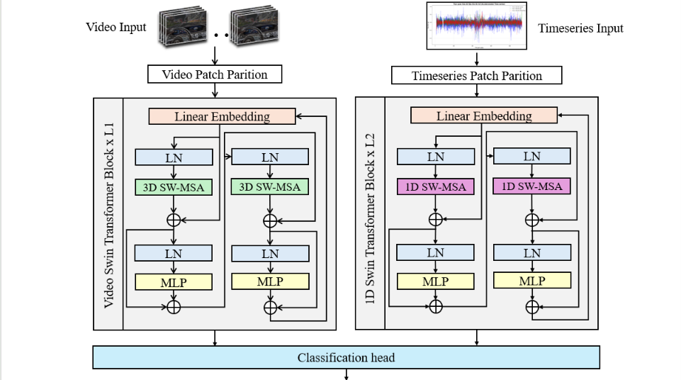
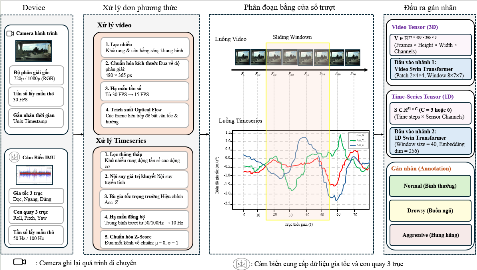
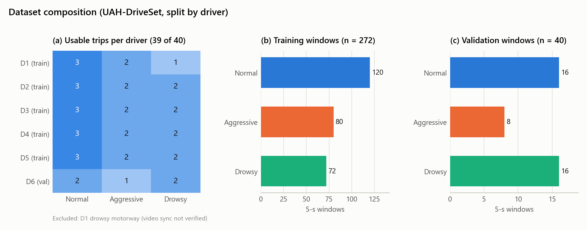
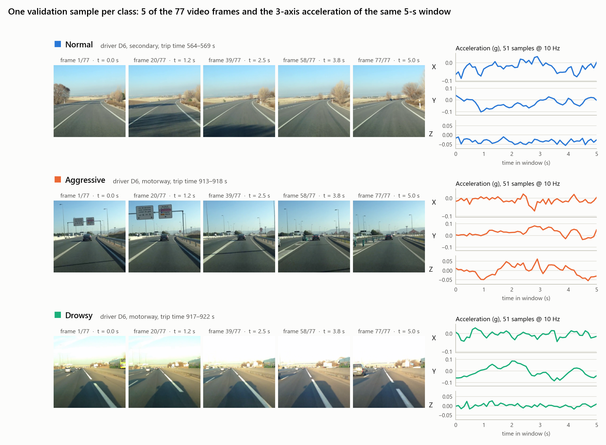
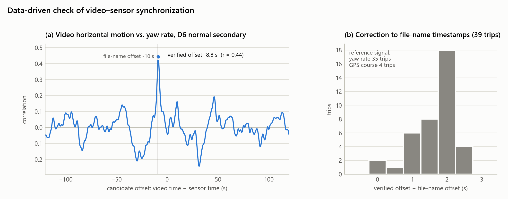
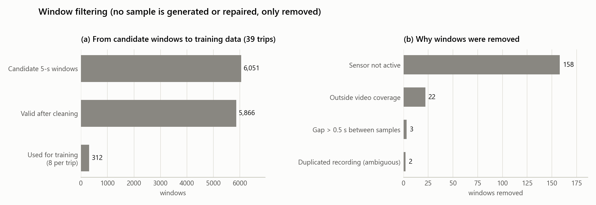
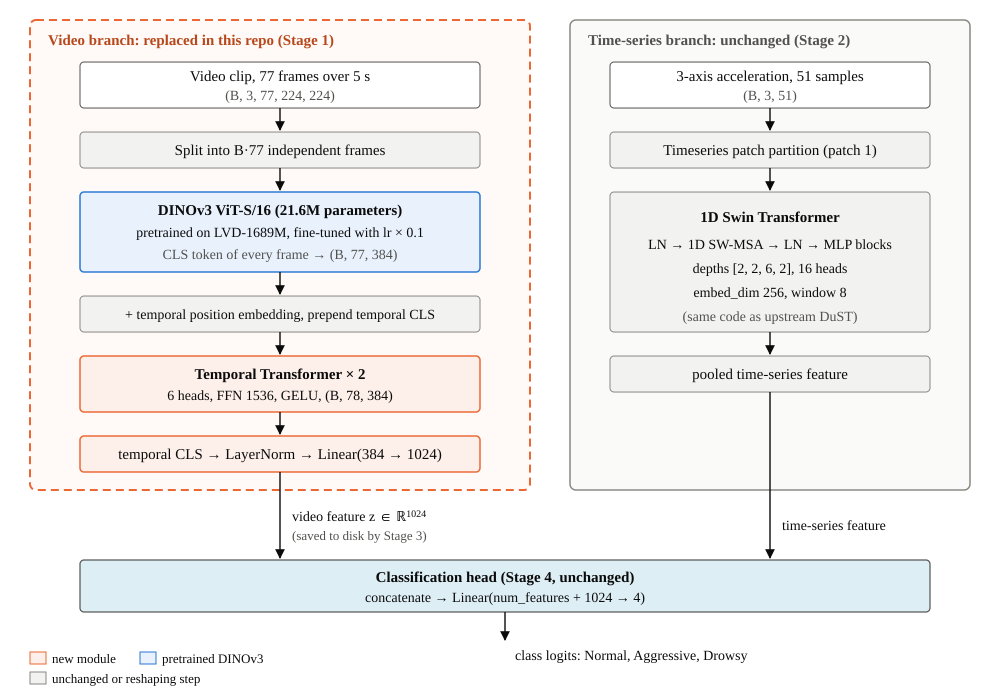
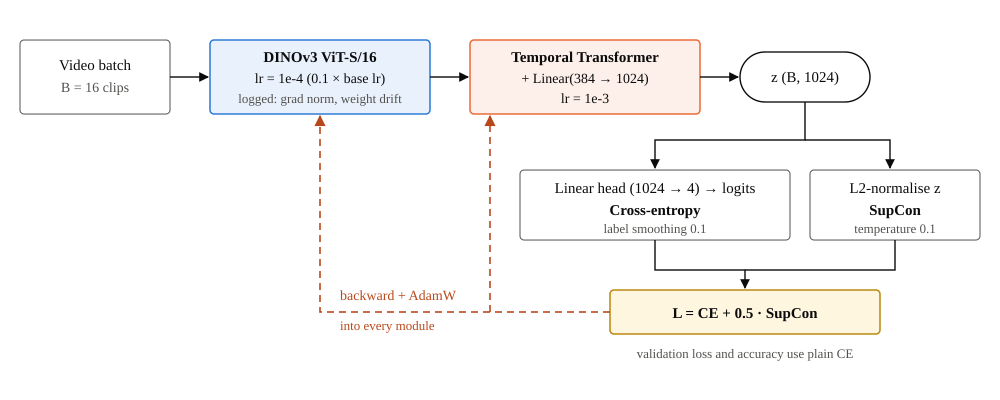
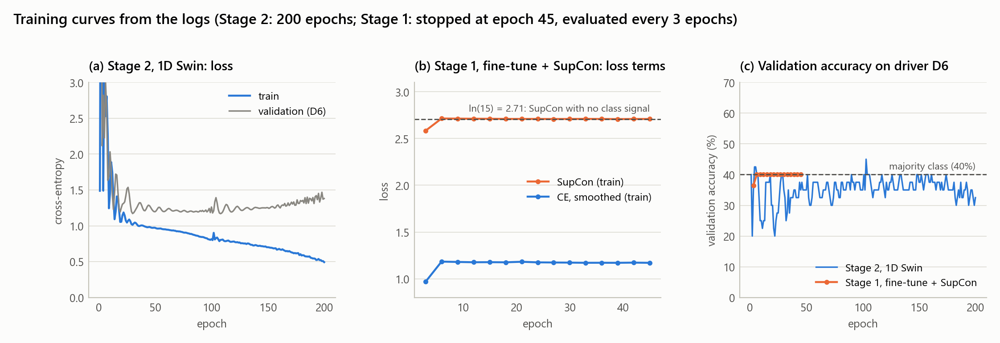

# DuST + DINOv3 for Driving-Behaviour Recognition

This project replaces the video encoder of **DuST** (Dual Swin Transformer) with a **pretrained DINOv3 ViT-S/16** and trains the model on real dash-cam video and accelerometer data from **UAH-DriveSet**. The goal is to classify driving behaviour as Normal, Aggressive or Drowsy. It builds on the upstream [DuST repository](https://github.com/datadrivenwheels/DUST) (Shi et al., CVPRW 2024).

**Status: research prototype.** The integration runs end to end:

- data cleaning
- the 4 training stages
- feature export
- a web demo

The best validation accuracy so far is 57.5% for the video branch, measured on 40 windows from one held-out driver. The latest fine-tuning run with the new loss did **not** learn (see [Section 7](#results)). The numbers below describe this prototype. They do not show that DINOv3 beats the original encoder, because the original encoder was never trained on the same data.

Contents: [Overview](#overview) · [Original DuST and data](#original-dust-and-data) · [DINOv3 integration](#dinov3-integration) · [Training objective](#training-objective) · [Setup](#setup) · [Run](#run) · [Results](#results) · [Troubleshooting](#troubleshooting) · [Limitations](#limitations) · [References](#references)

<a id="overview"></a>

## 1. Overview

| Item | This repository |
| --- | --- |
| Task | Classify a 5-second driving window as Normal, Aggressive or Drowsy |
| Intended readers | Students, supervisors and reviewers who want to reproduce or extend the integration |
| Dataset | UAH-DriveSet: 6 drivers, 40 trips, 3 behaviours; 39 trips pass the synchronization check |
| Model input | 77 video frames `(3, 77, 224, 224)` + 51 accelerometer samples `(3, 51)`, both covering the same ~5 s |
| Prediction | 4 logits (upstream `num_classes=4` kept; labels use indices 0–2) |
| Split | By driver: D1–D5 train, **D6 validation** (unseen driver) |
| Changed module | Video encoder only: Video Swin-B 3D → DINOv3 ViT-S/16 + Temporal Transformer |
| Unchanged | 4-stage training order, 1D Swin time-series branch, fusion head, input/feature shapes |
| New in training | Stage 1 loss: cross-entropy with label smoothing + supervised contrastive loss; DINOv3 fine-tuned with a 10× smaller learning rate |

This README answers two questions:

1. **How is DINOv3 integrated?** It replaces the 3D Video Swin encoder of Stage 1. The class keeps the same interface, so every later stage runs unchanged. See [Section 3](#dinov3-integration).
2. **How does the new encoder learn?** Through a combined loss that acts directly on the 1024-d feature that Stage 4 consumes, with DINOv3 itself updated at a reduced learning rate. See [Section 4](#training-objective).

<a id="original-dust-and-data"></a>

## 2. Original DuST and the Data Pipeline

### 2.1 Original architecture



*Figure 1. Original DuST architecture (redrawn). The video branch stacks 3D shifted-window attention blocks; the time-series branch stacks 1D shifted-window blocks; a classification head fuses both.*

DuST is trained in four stages:

1. Stage 1 trains the video branch alone.
2. Stage 2 trains the 1D Swin on kinematics alone.
3. Stage 3 exports one 1024-d feature per video clip.
4. Stage 4 trains the fusion model. It loads the Stage 2 weights and concatenates them with the exported video features before `Linear(num_features + 1024, 4)`.

The upstream repository ships only random toy data (`gen_data.py`).

### 2.2 Data pipeline



*Figure 2. Data pipeline overview (author's diagram, in Vietnamese). The exact settings used by `prepare_uah_data.py` are listed in the table below.*

[`prepare_uah_data.py`](prepare_uah_data.py) builds the training pickles from raw UAH-DriveSet. It follows one rule: **no sample is generated, interpolated or repaired**. A window that fails any check is removed.

| Step | What the code does |
| --- | --- |
| Kinematics | 51 consecutive Kalman-filtered accelerometer samples (X/Y/Z, ~10 Hz, ≈5 s); z-score using train-set statistics |
| Video | 77 real frames spread evenly over the same time span; centre crop to 224 × 224; ImageNet normalization; stored as float16 |
| Cleaning | Drop duplicated timestamps, timestamps that jump backwards and duplicated recording segments. Reject windows that have a sample gap > 0.5 s, an inactive sensor, no video coverage, missing or dark frames, or a frozen video while the car moves |
| Synchronization | Correlate the horizontal optical flow of the horizon band with the yaw rate (GPS course rate as fallback) to find the real video offset. Trips that cannot be verified are dropped |
| Split | By driver (D6 = validation) to avoid identity leakage |
| Audit files | `windows_*.csv` (one row per sample, same order as the pickles) and `uah_trip_report.csv` (status and rejection reasons per trip) |



*Figure 3. Dataset composition. One trip (D1, drowsy, motorway) is removed because its video offset cannot be verified.*



*Figure 4. One validation window per class, exactly as the model receives it. Each window is the one whose acceleration variability is closest to its class median, so the examples were not hand-picked.*



*Figure 5. Synchronization check. (a) A clear correlation peak gives the real offset of one trip. (b) The real offset differs from the offset in the file name by +1.8 s (median) across the 39 trips.*



*Figure 6. Window filtering. Of the 6,051 candidate windows, 185 are removed. The run reported here used 8 windows per trip because of the memory needed for the video branch.*

All figures in `visualization/figures/` (except the two diagrams drawn by hand) are produced by [`visualization/make_figures.py`](visualization/make_figures.py). Before saving, the script checks each figure for overlapping text and axes. [`docs/README_DATA.md`](docs/README_DATA.md) documents the dataset and every cleaning rule (in Vietnamese).

<a id="dinov3-integration"></a>

## 3. DINOv3 Integration: Why, Where and How

**Integration decision:**

- Encode every frame with a pretrained DINOv3 and keep its CLS token.
- Model the 77-frame sequence with a small Temporal Transformer.
- Project the result to the same 1024-d feature that the original encoder produced.

Everything after this feature is unchanged.

### 3.1 Why replace the video encoder?

The original Video Swin-B 3D has about 88M parameters. It starts from 2D ImageNet weights inflated to 3D, and it is fine-tuned end to end. UAH-DriveSet gives only a few hundred to a few thousand 5-second clips, which is small for training that many parameters.

DINOv3 ViT-S/16 is a 21.6M-parameter self-supervised backbone pretrained on 1.7 billion images (LVD-1689M). Its frame features already describe road layout, lane position and scene motion. The model therefore only needs to learn how those features change over time.

The trade-off is that spatial and temporal modelling are now separate. DINOv3 sees each frame alone, and only the Temporal Transformer mixes information across frames.

### 3.2 What changes in the architecture

```text
Original video branch: video → Video Swin-B 3D (3D SW-MSA, patch merging) → AdaptiveAvgPool3d → 1024
New video branch:      video → DINOv3 ViT-S/16 per frame → CLS (77 × 384)
                             → Temporal Transformer × 2 → LayerNorm → Linear(384 → 1024)

Shared downstream path: 1024-d video feature + 1D Swin feature → fusion head → 4 logits
```



*Figure 7. DuST-DINOv3. The dashed orange panel is the only part that differs from Figure 1. Its output shape `(B, 1024)` matches the original encoder, so Stages 2–4 run without modification.*

[`DINOv3VideoEncoder`](models/dinov3_video_encoder.py#L42) keeps the interface of the original `SwinTransformer3D`. `get_vid_feature(x)` returns `(B, 1024)` and `forward(x)` returns logits:

```python
def get_vid_feature(self, x):
    """Same as SwinTransformer3D.get_vid_feature(): (B, C, D, H, W) -> (B, 1024)."""
    return self._temporal_aggregate(self._extract_frame_features(x))

def forward(self, x):
    return self.head(self.get_vid_feature(x))
```

### 3.3 Where DINOv3 comes from and how it is loaded

The checkpoint is `timm/vit_small_patch16_dinov3.lvd1689m`. Download `model.safetensors` (≈86 MB, SHA-256 `2a1ec16ae28ffa07bc0ead0241ee7df9fc26451fe6f9f839b7b3afa0a906b040`) and place it next to `step_dinov3_3d.py`.

The encoder [loads it through timm](models/dinov3_video_encoder.py#L99-L105) with `global_pool='token'`. Without that argument, timm averages the patch tokens for DINOv3 by default. If the file path is wrong, the encoder raises an error instead of silently starting from random weights. If timm fails, the encoder falls back to `transformers.AutoModel`.

### 3.4 Tensor interfaces

| Step | Operation and output |
| --- | --- |
| Frame split | `(B, 3, 77, 224, 224)` → `(B·77, 3, 224, 224)` |
| DINOv3 | Processed in chunks of 16 frames to bound memory; CLS token per frame → `(B, 77, 384)` (1 CLS + 4 register tokens; patch tokens discarded) |
| Temporal model | + learned temporal position embedding, prepend a temporal CLS → `(B, 78, 384)` → `nn.TransformerEncoder` (2 layers, 6 heads, FFN 1536, GELU) |
| Projection | temporal CLS → LayerNorm → `Linear(384, 1024)` → `(B, 1024)` = the feature exported by Stage 3 |
| Head | `Linear(1024, 4)`; used only to train Stage 1 |

[`_extract_frame_features()`](models/dinov3_video_encoder.py#L190-L206) runs the backbone chunk by chunk. When the encoder is built with `freeze_backbone=True`, it runs under `torch.no_grad()` and `train()` keeps DINOv3 in `eval()` mode.

### 3.5 Component changes and the code path to follow

| Component | Original DuST | This repository |
| --- | --- | --- |
| Video encoder | Video Swin-B 3D, `embed_dim=128`, `depths=[2,2,18,2]` | DINOv3 ViT-S/16 + Temporal Transformer |
| Video pretraining | Swin-B ImageNet, 2D → 3D inflation | DINOv3 LVD-1689M |
| Video pooling | `AdaptiveAvgPool3d` → 1024 | temporal CLS → `Linear(384 → 1024)` |
| Stage 1 parameters | ~88M | 25.6M (21.6M in DINOv3) |
| Stage 1 loss | Cross-entropy | CE (label smoothing 0.1) + 0.5 · SupCon |
| Video input / exported feature | `(B, 3, 77, 224, 224)` / `(N, 1024)` | Unchanged |
| 1D Swin (Stage 2), fusion (Stage 4) | `embed_dim=256` / `Linear(num_features + 1024, 4)` | Unchanged (Stage 4 `embed_dim` fixed to match Stage 2, see below) |
| Checkpoints | One file per evaluation (~150 GB per stage for the 1D model) | `best_*.pth` + `final_*.pth`; `--save_all_epochs` restores the original behaviour |
| Data | Random toy data | Real UAH-DriveSet via `prepare_uah_data.py` |

| Stage | Script (upstream name) | Responsibility |
| --- | --- | --- |
| 0 | [`prepare_uah_data.py`](prepare_uah_data.py) (`gen_data.py`) | Clean, synchronize and window UAH-DriveSet into pickles |
| 1 | [`step_dinov3_3d.py`](step_dinov3_3d.py) (`step_fusion_3d.py`) | Train the DINOv3 video encoder |
| 2 | [`step_fusion_1d.py`](step_fusion_1d.py) | Train the 1D Swin on kinematics (logic unchanged) |
| 3 | [`step_dinov3_3d_get_feature.py`](step_dinov3_3d_get_feature.py) (`step_fusion_3d_get_feature.py`) | Export `(N, 1024)` video features |
| 4 | [`step_fusion.py`](step_fusion.py) | Train the fusion model (logic unchanged) |
| all | [`notebooks/run_colab.ipynb`](notebooks/run_colab.ipynb) | Run Stages 0–4 on Google Colab |

Two upstream bugs are fixed on the way:

| Upstream bug | Effect | Fix |
| --- | --- | --- |
| `step_fusion.py` builds the 1D Swin with `embed_dim=128`, while Stage 2 trains it with `embed_dim=256` | Stage 4 cannot load the Stage 2 weights (`size mismatch`) | [`embed_dim=256`](step_fusion.py#L176-L179) |
| Stage 3 exports train features with `shuffle=True` | Video features no longer line up with kinematics and labels in Stage 4 | [`shuffle=False`](step_dinov3_3d_get_feature.py#L146) |

A file-by-file list of the changes, with diffs, is in [`docs/CHANGES.md`](docs/CHANGES.md).

<a id="training-objective"></a>

## 4. Training Objective and Parameter Updates

**Training decision:** keep the classification target, but change how Stage 1 shapes the feature that the rest of the pipeline uses:

- Cross-entropy with label smoothing trains the classifier.
- A supervised contrastive term (SupCon) acts directly on the 1024-d feature `z`, which Stage 3 exports and Stage 4 fuses.
- DINOv3 is fine-tuned, but at 0.1× the learning rate of the new modules.

Stages 2 and 4 keep the original plain cross-entropy.



*Figure 8. One Stage 1 training step. Both DINOv3 (lr 1e-4) and the new modules (lr 1e-3) receive gradients. Validation loss and accuracy are measured with plain cross-entropy, so they stay comparable with the original DuST.*

### 4.1 Why each term

- **Label smoothing (ε = 0.1).** UAH labels belong to a whole trip: a driver is asked to drive "aggressively" for 10–25 minutes. Many 5-second windows in such a trip look normal, so a hard one-hot target over-penalizes those windows.
- **SupCon on `z` (weight λ = 0.5, temperature τ = 0.1).** `z` is the only thing the fusion stage sees from the video branch. SupCon pulls clips of the same class together and pushes other classes apart in that space. Cross-entropy only needs the classes to be linearly separable through the head.
- **Fine-tuning DINOv3 at lr × 0.1.** Dash-cam frames differ from DINOv3's web images. A small learning rate lets the backbone adapt without erasing what it learned in pretraining.

### 4.2 Loss definition

For a batch with logits $s_i$, labels $y_i$, $K = 4$ outputs and L2-normalized features $\hat z_i = z_i / \lVert z_i \rVert$:

$$
\mathcal{L}_{\text{CE}}=-\frac{1}{B}\sum_{i=1}^{B}\sum_{c=1}^{K} q_{i,c}\log\operatorname{softmax}(s_i)_c,\qquad
q_{i,c}=(1-\varepsilon)\,\mathbb{1}[c=y_i]+\frac{\varepsilon}{K}
$$

$$
\mathcal{L}_{\text{SupCon}}=\frac{1}{\lvert A\rvert}\sum_{i\in A}\frac{-1}{\lvert P(i)\rvert}\sum_{p\in P(i)}
\log\frac{\exp(\hat z_i\cdot\hat z_p/\tau)}{\sum_{a\neq i}\exp(\hat z_i\cdot\hat z_a/\tau)}
$$

$$
\mathcal{L}=\mathcal{L}_{\text{CE}}+\lambda\,\mathcal{L}_{\text{SupCon}},\qquad \varepsilon=0.1,\ \tau=0.1,\ \lambda=0.5
$$

$P(i)$ is the set of other samples in the batch with the same label as $i$, and $A$ is the set of samples with at least one positive. If the features carried no class information, every $\hat z_i\cdot\hat z_a$ would be equal and $\mathcal{L}_{\text{SupCon}} = \ln(B-1)$, which is 2.71 for $B = 16$. This value is used as a diagnostic in [Section 7](#results).

### 4.3 Implementation

[`supcon_loss()`](step_dinov3_3d.py#L74) computes the term in float32 so that bf16 mixed precision stays stable:

```python
z = F.normalize(features.float(), dim=1)
sim = z @ z.t() / temperature
sim = sim.masked_fill(eye, -1e9)                     # exclude the anchor itself
pos = (labels[:, None] == labels[None, :]) & ~eye     # positives: same label, other sample
log_prob = sim - torch.logsumexp(sim, dim=1, keepdim=True)
mean_log_prob_pos = (log_prob * pos).sum(dim=1)[valid] / pos_count[valid]
return -mean_log_prob_pos.mean()
```

The [training step](step_dinov3_3d.py#L295-L345) uses two parameter groups and the combined loss:

```python
criterion_train = nn.CrossEntropyLoss(label_smoothing=args.label_smoothing)
param_groups = [{'params': head_params, 'lr': lr},                         # temporal + projection + head
                {'params': backbone_params, 'lr': lr * args.backbone_lr_mult}]  # DINOv3
optimizer = optim.AdamW(param_groups, lr=lr, betas=(0.9, 0.999), weight_decay=0.02)
...
feat = model.get_vid_feature(inputs_3d)    # z, (B, 1024)
logits = model.head(feat)
loss = ce(logits, labels) + args.supcon_weight * supcon_loss(feat, labels, args.supcon_temp)
```

The optimizer (AdamW, `weight_decay=0.02`), scheduler (`CombinedLRScheduler`), base learning rate (1e-3) and evaluation loop are the upstream ones.

To show that DINOv3 really changes, the script logs two quantities:

- the gradient norm of the backbone every 50 batches;
- the weight drift $\lVert W - W_0\rVert / \lVert W_0\rVert$ at every evaluation.

At the end it writes `dino_drift.json`.

| Component | Learnable | Learning rate |
| --- | --- | --- |
| DINOv3 ViT-S/16 (21.6M) | Yes (frozen with `--freeze_backbone`) | 1e-4 |
| Temporal position embedding, temporal CLS, Temporal Transformer | Yes | 1e-3 |
| LayerNorm + `Linear(384 → 1024)` | Yes | 1e-3 |
| Stage 1 head `Linear(1024 → 4)` | Yes; discarded after Stage 1 | 1e-3 |
| Loss functions | No parameters | — |

| Flag | Default | Meaning |
| --- | --- | --- |
| `--freeze_backbone` | off | Freeze DINOv3 (no gradients, `eval()` mode) |
| `--backbone_lr_mult` | `0.1` | DINOv3 learning rate = `lr ×` this value |
| `--label_smoothing` | `0.1` | ε of the cross-entropy |
| `--supcon_weight` / `--supcon_temp` | `0.5` / `0.1` | λ and τ; `--supcon_weight 0` disables SupCon |
| `--no_amp` | off | Disable bf16 autocast |
| `--dinov3_model` / `--dinov3_weights` | `vit_small_patch16_dinov3.lvd1689m` / `model.safetensors` | Backbone name and local weight file (`""` = download) |
| `--temporal_layers` / `--temporal_heads` / `--chunk_size` | `2` / auto (6) / `16` | Temporal model size and frames per backbone call |

<a id="setup"></a>

## 5. Environment and Setup

### 5.1 Tested environment

| Item | Verified environment |
| --- | --- |
| Training | Google Colab, NVIDIA A100, PyTorch 2.11 + CUDA, bf16 autocast |
| Local checks | Windows 11, CPU, PyTorch 2.12 |
| Libraries | timm 1.0.27–1.0.28 (needs a version with DINOv3), opencv-python 4.13, numpy, pandas, safetensors |
| External files | `model.safetensors` (DINOv3) and UAH-DriveSet (`DRIVERSET_H`), neither included |

### 5.2 Install

```bash
git clone https://github.com/huylee333/Checking-Driver.git
cd Checking-Driver
pip install -r requirements.txt
python -c "import timm, torch; print(torch.__version__, timm.__version__, torch.cuda.is_available())"
```

Expected: a timm version ≥ 1.0.20 and `True` on a GPU machine.

### 5.3 Pretrained weights and data

1. Download `model.safetensors` from the Hugging Face repo `timm/vit_small_patch16_dinov3.lvd1689m` into the repository root. Check its SHA-256 against [Section 3.3](#dinov3-integration).
2. Request UAH-DriveSet from its [official page](http://www.robesafe.uah.es/personal/eduardo.romera/uah-driveset/) and extract it so that `UAH-DRIVESET-v1/D1 … D6` exist.

Expected layout:

```text
Checking-Driver/
├── model.safetensors
├── step_dinov3_3d.py  ...
└── ../UAH-DRIVESET-v1/   (or pass --uah_root)
```

<a id="run"></a>

## 6. Run the Pipeline

All commands run from the repository root. Default paths read from `data/` and write to `saved_models/`, `video_features/` and `logs/`.

### 6.1 Prepare the data

```bash
python prepare_uah_data.py --uah_root ../UAH-DRIVESET-v1 --out_dir data --check_only
python prepare_uah_data.py --uah_root ../UAH-DRIVESET-v1 --out_dir data \
       --offset_override 20151120164606-16km-D2-DROWSY-SECONDARY=2
```

Expected:

- `--check_only` writes only `data/uah_trip_report.csv`.
- With the override, 39 of 40 trips are `OK`. The override is needed because the file name of trip D2-DROWSY-SECONDARY gives an offset of −598 s; the override sets it to +2 s, and the trip still has to pass the yaw-rate check.
- The second command adds `video_*.pkl`, `kine_*.pkl`, `label_*.pkl`, `windows_*.csv` and `kine_norm_stats.json`.

The default is up to 40 windows per trip (`--max_windows_per_trip`). Video pickles grow by about 23 MB per window.

### 6.2 Train the four stages

```bash
python step_dinov3_3d.py                   # Stage 1: DINOv3 video encoder (fine-tune + SupCon)
python step_fusion_1d.py                   # Stage 2: 1D Swin on kinematics
python step_dinov3_3d_get_feature.py --path_3d_model saved_models/step_3d/best_3d.pth   # Stage 3
python step_fusion.py                      # Stage 4: fusion
```

Expected outputs:

| Stage | Files | Log lines to check |
| --- | --- | --- |
| 1 | `saved_models/step_3d/best_3d.pth`, `final_3d.pth`, `val_loss.npy`, `val_acc.npy`, `dino_drift.json` | `Total params: 25,564,932`, `backbone lr=0.0001 \| backbone params=21,586,944`, then per evaluation `Train Loss: … (CE …, SupCon …)` and `DINOv3 weight drift` |
| 2 | `saved_models/step_1d/best_1d.pth`, `final_1d.pth` | `epoch … minimize val loss` |
| 3 | `video_features/train_3d_features.pkl`, `val_3d_features.pkl`, shape `(N, 1024)` | — |
| 4 | `saved_models/step_fusion/best_fusion.pth`, `final_fusion.pth` | — |

Stage 3 must use the same `--dinov3_model_name`, `--temporal_layers` and `--temporal_heads` as Stage 1, otherwise `load_state_dict` fails. To reproduce the frozen-backbone run of [Section 7](#results), add `--freeze_backbone --supcon_weight 0 --label_smoothing 0` to Stage 1.

On Colab, [`notebooks/run_colab.ipynb`](notebooks/run_colab.ipynb) runs all of the above. It reads the code and data from Google Drive and copies the data to the local disk first.

### 6.3 Reproduce the figures

```bash
python visualization/make_figures.py            # Figures 3–6 and 9
python visualization/make_figures.py --only 6   # training curves only (needs runs/<run>/logs)
```

Expected: `[layout] … OK` for every figure and `total layout issues: 0`.

<a id="results"></a>

## 7. Results

The validation set is driver D6, whom the model never sees during training. Accuracy is measured per 5-second window. A model that always predicts the majority class scores **40%**.

| Run | Data | Model | Validation accuracy (D6) |
| --- | --- | --- | --- |
| A | 8 windows/trip: 272 train, 40 val | Stage 1, DINOv3 **frozen**, plain CE | **57.5%** (epoch 18) |
| A | same | Stage 2, 1D Swin | 32.5% final, 45.0% best (epoch 103) |
| A | same | Stage 4, fusion | 42.5% (epoch 17) |
| B | up to 40 windows/trip | Stage 1, DINOv3 **fine-tuned** + CE (ε = 0.1) + 0.5 · SupCon | 40.0% from epoch 6 on (stopped at epoch 45) |

The log of Run A's Stage 1 was overwritten by Run B; its result comes from the saved checkpoint. The models of Run A are the ones served in the [web demo](https://huggingface.co/spaces/huy-le/Checking-Driver).



*Figure 9. Training curves parsed from the logs. (a) Stage 2 overfits: train loss falls from 1.49 to 0.49 while validation loss rises after epoch ~110. (b) In Run B, SupCon sits at ln 15 = 2.71 from epoch 6: the features carry no class information in a batch. (c) Validation accuracy of Run B equals the majority-class rate.*

What the evidence shows:

- **The new loss path executes and updates DINOv3.** In Run B, the backbone gradient norm is non-zero (10⁻⁴–10⁻²) and the weight drift grows from 0.75% (epoch 3) to 1.37% (epoch 45).
- **Run B did not learn.** SupCon at its no-information value, CE flat at ≈1.17 and accuracy at 40% together point to a collapsed representation. The probable causes have not been tested yet:
  - noisy trip-level labels;
  - batch 16 with 3 classes, which gives few positives per anchor;
  - learning rate 1e-3 for the new modules from the first epoch.
- **Kinematics alone separate the classes weakly** (see `visualization/figures/fig3_acceleration_variability.png`). The per-window acceleration spread overlaps strongly across classes, which is consistent with the 1D branch staying below the majority baseline.

<a id="troubleshooting"></a>

## 8. Troubleshooting

| Symptom | Check / action |
| --- | --- |
| `FileNotFoundError: … model.safetensors` | Put the file next to `step_dinov3_3d.py`, pass `--dinov3_weights /path/model.safetensors`, or pass `--dinov3_weights ""` to download it |
| timm cannot find `vit_small_patch16_dinov3` | Upgrade timm (≥ 1.0.20) |
| CUDA out of memory in Stage 1 or 3 | Lower `--chunk_size` (frames per DINOv3 call) or `--batch_size`; Stage 3 defaults to batch 8 |
| `size mismatch` when Stage 3 loads Stage 1 | Use the same DINOv3 model and temporal settings in both stages |
| `size mismatch` when Stage 4 loads Stage 2 | Use this repo's `step_fusion.py` (`embed_dim=256`), not the upstream one |
| Out of RAM while loading video pickles | Lower `--max_windows_per_trip` in Stage 0; video is ~23 MB per window in float16 |
| A trip is reported as `sync_failed` | Inspect its row in `uah_trip_report.csv`. Use `--offset_override TRIP=SECONDS` only for a trip you have checked by hand |
| `UnicodeEncodeError` on a Windows console | Set `PYTHONIOENCODING=utf-8` |

<a id="limitations"></a>

## 9. Limitations and Next Steps

- One validation driver and 40 windows (Run A) make every accuracy figure noisy. A single window changes accuracy by 2.5 points.
- UAH labels are per trip, so many windows carry the wrong behaviour label.
- The original Video Swin-B 3D has not been trained on the same data, so the effect of DINOv3 relative to the upstream encoder is still unmeasured.
- Run B (fine-tuning + SupCon) collapsed. Next steps:
  1. Warm up with CE only before adding SupCon.
  2. Use a larger batch, or a class-balanced sampler, so that each anchor has positives.
  3. Lower the learning rate of the new modules.
  4. Repeat Stage 3 and Stage 4 with the resulting encoder.
- The 1D branch uses only 312 of the 5,866 valid windows. Kinematic data is light, so it can be trained on all of them independently of the video limit.

<a id="references"></a>

## 10. References, License and Maintenance

- L. Shi, Y. Chen, M. Liu, F. Guo. [DuST: Dual Swin Transformer for Multi-modal Video and Time-Series Modeling](https://openaccess.thecvf.com/content/CVPR2024W/WAD/html/Shi_DuST_Dual_Swin_Transformer_for_Multi-modal_Video_and_Time-Series_Modeling_CVPRW_2024_paper.html). CVPR Workshops 2024, pp. 4537–4546. [Upstream code](https://github.com/datadrivenwheels/DUST).
- O. Siméoni et al. [DINOv3](https://arxiv.org/abs/2508.10104), 2025. [Official repository](https://github.com/facebookresearch/dinov3); [timm checkpoint](https://huggingface.co/timm/vit_small_patch16_dinov3.lvd1689m).
- P. Khosla et al. [Supervised Contrastive Learning](https://arxiv.org/abs/2004.11362). NeurIPS 2020.
- E. Romera, L. M. Bergasa, R. Arroyo. "Need Data for Driving Behavior Analysis? Presenting the Public UAH-DriveSet". IEEE ITSC 2016.

Maintainer: [huylee333](https://github.com/huylee333).

Licensing:

- The code is MIT and inherits the upstream DuST copyright notice in [LICENSE](LICENSE).
- DINOv3 weights follow Meta's DINOv3 License and are not included.
- UAH-DriveSet is for non-commercial use and is not redistributed here. Models trained on it inherit that restriction.
